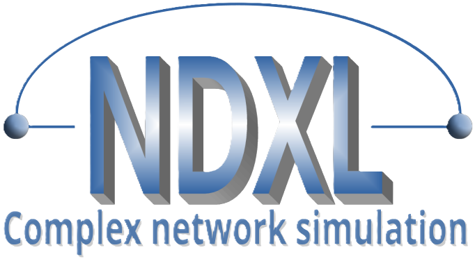
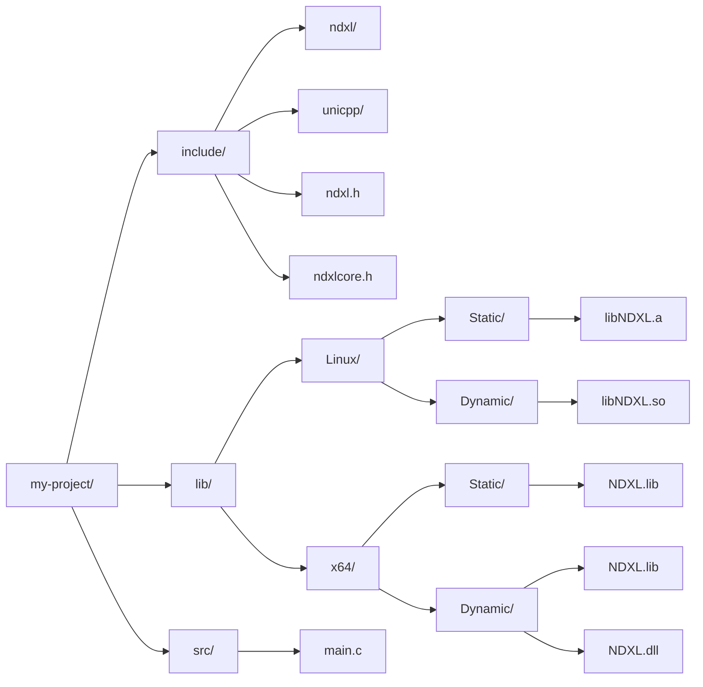

This page serves as a brief introduction to the raw C API.
We will proceed assuming you have acquired the precompiled binaries and header files, and that your working tree looks something like this:



## Writing
To use NDXL, we need to do two things: initialise the library (which registers garbage collection and initialises internal state variables), and create a host network for our agents to exist on.
In `main.c`, we achieve this by calling `ndxlInit()` and `ndxlCreateNetwork()`, respectively.

```C
#include "../include/ndxl.h"

int main(int argc, char** argv)
{
    // MUST be called before any calls to NDXL functions
    ndxlInit();
    
    // We pass "0" for the user-defined `void* _Params`
    NDXLNetwork* nwk = ndxlCreateNetwork(0);
    
    return 0;
}
```

The next task is to define the dynamics functions of our agents, on a per-agent basis, before `main()` so that agents created in `main()` can reference them.
Our goal is to simulate a network of Kuramoto oscillators; in this network, a vertex is an oscillator, and an edge is a coupling between two oscillators.
Since coupling in the Kuramoto model is static, we need only define the dynamics for our vertices.

```C
#include <math.h>

int kuramoto(NDXLVertex* vert, double* dtheta, const double* theta, double time, void* params)
{
    // Extract eigenfrequency from user-supplied `void* params`
    double omega = *(double*)params;
    
    // Iterate over only the vertices coupled to `vert` to get the coupling sum
    double coupling = 0.0;
    for (NDXLEdge* edge = ndxlGetVertexFirstEdge(vert); edge; edge = ndxlGetVertexNextEdge(vert, edge))
        coupling += ndxlGetEdgeState(edge)[0] * sin(ndxlGetVertexNeighbourState(vert, edge)[0] - theta[0]);
    
    // Write derivative output in-place to dtheta
    dtheta[0] = omega + coupling;
    
    // Indicate function success; any nonzero value means failure and terminates simulation immediately
    return 0;
}
```

The function above indicates our intent to have the eigenfrequency of an oscillator passed as its user-defined `void* params`.
In NDXL, this pointer is not copied, so we must ensure that the data pointed to by this pointer persists over the lifetime of the object using it.
Conversely, the state vector for a vertex is copied, so it does not matter where we create it.
We extend our `main()` above to include oscillator creation.

```C
int main(int argc, char** argv)
{
    ndxlInit();
    NDXLNetwork* nwk = ndxlCreateNetwork(0);
    
    // Create persistent eigenfrequencies in memory
    double omega[5] = { 9.9, 9.95, 10.0, 10.5, 10.1 };
    
    // Create network and storage space for our oscillators
    NDXLVertex* oscillators[5];
    
    // Add five Kuramoto oscillators equally spaced in phase space
    for (int i = 0; i < 5; i++)
    {
        // PI and TWO_PI are defined in "../include/unicpp/unicpp_vals.h"
        const double theta0 = -PI + (i / 4.0) * TWO_PI;
        oscillators[i] = ndxlCreateVertex(
            nwk,        // Host network
            &theta0,    // Initial state vector
            1,          // Number of elements in state vector
            kuramoto,   // Dynamics
            NULL,       // No noise
            NULL,       // Noise channels array - must be NULL if noise is NULL
            0,          // Number of elements in noise channels array - must be 0 if noise is NULL
            NULL,       // No vertex discrete callback
            &omega[i]   // User-defined `void* params`
        );
    }
    
    return 0;
}
```

We now define the topology by constructing edges between the vertices created in `main()`.
In this example, we will create a ring network with uniform coupling `K`.

```C
int main(int argc, char** argv)
{
    ndxlInit();
    NDXLNetwork* nwk = ndxlCreateNetwork(0);
    NDXLVertex* oscillators[5];
    
    for (int i = 0; i < 5; i++)
    {
        const double theta0 = -PI + (i / 4.0) * TWO_PI;
        oscillators[i] = ndxlCreateVertex(nwk, &theta0, 1, kuramoto, NULL, NULL, 0, NULL, &omega[i]);
    }

    const double K = 1.0;
    for (int i = 0; i < 5; i++)
    {
        ndxlCreateEdge(
            oscillators[i],             // 'Source' vertex of edge
            oscillators[(i + 1) % 5],   // 'Destination' vertex of edge
            &K,                         // Initial state vector
            1,                          // Length of state vector
            0.0,                        // Delay (for defining DDEs)
            0,                          // Not directed (any truthy value makes the edge directed)
            NULL,                       // No dynamics (static edge)
            NULL,                       // No noise
            NULL,                       // Noise channels array - must be NULL if noise is NULL
            0,                          // Number of elements in noise channels array - must be 0 if noise is NULL
            NULL,                       // No edge discrete callback
            NULL                        // No extra parameters on edges
        );
    }
    
    return 0;
}
```

One last thing before we can simulate the network is to define how outputs are captured.
For this, we use a discrete network callback, also defined before `main()`, which is called once at `t=0`, then again after each successful simulation step.
In our callback, we will write the oscillator phases to an output file.

```C
#include <stdio.h>

int cb(NDXLNetwork* nwk, double time, void* params)
{
    // Extract file pointer from params
    FILE* f_output = (FILE*)params;
    
    // Write current time to file
    fprintf(f_output, "%f", time);
    
    // Iterate over all vertices and write their phases out
    for (NDXLVertex* vert = ndxlGetNetworkFirstVertex(nwk); vert; vert = ndxlGetNetworkNextVertex(vert))
        fprintf(f_output, ",%f", ndxlVertexState(vert)[0]);
    
    // As with dynamics, any nonzero return value indicates failure
    fprintf(f_output, "\n");
    return 0;
}
```

We modify `main()` one last time to: create the file, write the CSV headers, simulate the network, and pass the callback to the simulation function.
Simulation will be done using the Dormand-Prince Runge-Kutta pair of order 5(4).

```C
int main(int argc, char** argv)
{
    ndxlInit();
    
    // Create file pointer and write headers
    FILE* f_output = fopen("phases.csv", "w");
    if (f_output == NULL)
        return 1;
    fprintf(f_output, "time,phase0,phase1,phase2,phase3,phase4\n");
    
    // Change our network's `void* params` to contain the file
    NDXLNetwork* nwk = ndxlCreateNetwork(f_output);
    
    // ----- INSERT VERTEX AND EDGE CREATION CODE FROM ABOVE HERE -----
    
    ndxlNetworkSimulate(
        nwk,    // Target network to simulate
        10.0,   // Length of simulation (starts at ndxlGetNetworkTime(nwk), which is 0 when created)
        1e-6,   // Absolute tolerance
        1e-3,   // Relative tolerance
        NULL,   // No time-stops array (forced evaluation points)
        0,      // Length of time stops array - must be 0 if time stops is NULL
        cb      // Discrete callback
    );
    
    // Cleanup
    fclose(f_output);

    // Because we called ndxlInit(), all remaining NDXL objects are automatically and safely released when the program terminates
    // You can still manually destroy objects using their destructors, as detailed in the documentation
    return 0;
}
```

## Compiling
For compiling with MSVC, see [how to compile and link against libraries](https://learn.microsoft.com/en-us/cpp/build/walkthrough-creating-and-using-a-static-library-cpp?view=msvc-170).
Note that if you are linking against the dynamic library `NDXL.dll`, the dll must be in the same directory as the executable else it will not run!

If compiling with `gcc`, make sure to supply the path to the library files using the `-L` flag, and to link against both NDXL and the standard math library.
We will use the Unix static library as an example here, though the process is identical for the macOS and dynamic libraries.

```
gcc -o my-project.out src/main.c -Iinclude -Llib/Unix/Static -lNDXL -lm
```

As with MSVC, if you are linking against the dynamic library `libNDXL.so/dylib`, ensure the library is discoverable by the operating system's runtime loader when executing.

## Output
Congratulations! You now have an output file, "phases.csv", containing the simulated outputs of all five oscillators over time.

With this example, we have covered the fundamental steps involved in using NDXL: initialising the library, creating a network, defining agent dynamics, constructing network topology, and executing a simulation with custom output handling.

This is, of course, only a small demonstration of what NDXL can do. Vertices and edges can have independent dynamics, state vectors can have arbitrary dimensions, and simulations can incorporate stochastic processes, delays, and dynamically changing network structures.

For a more comprehensive understanding of the library, including its architecture, available functions, numerical methods, and additional examples, please refer to the [documentation](https://github.com/NonlinearC/NDXL).

## License
NDXL is released under the GNU GPL-3.0 license, allowing users to create their own derivative works and distribute them under the same licensing conditions.
Official language bindings are distributed under the same licence.
Users are also welcome to develop their own external wrappers for NDXL (see the [documentation](https://github.com/NonlinearC/NDXL) for details).