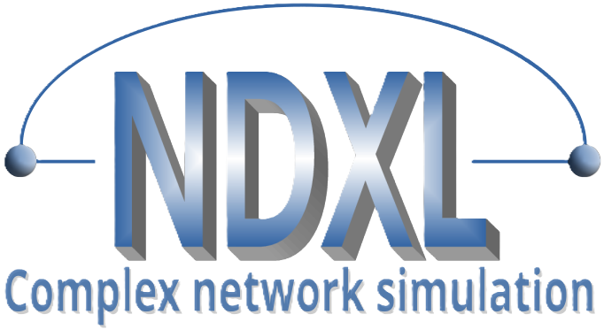
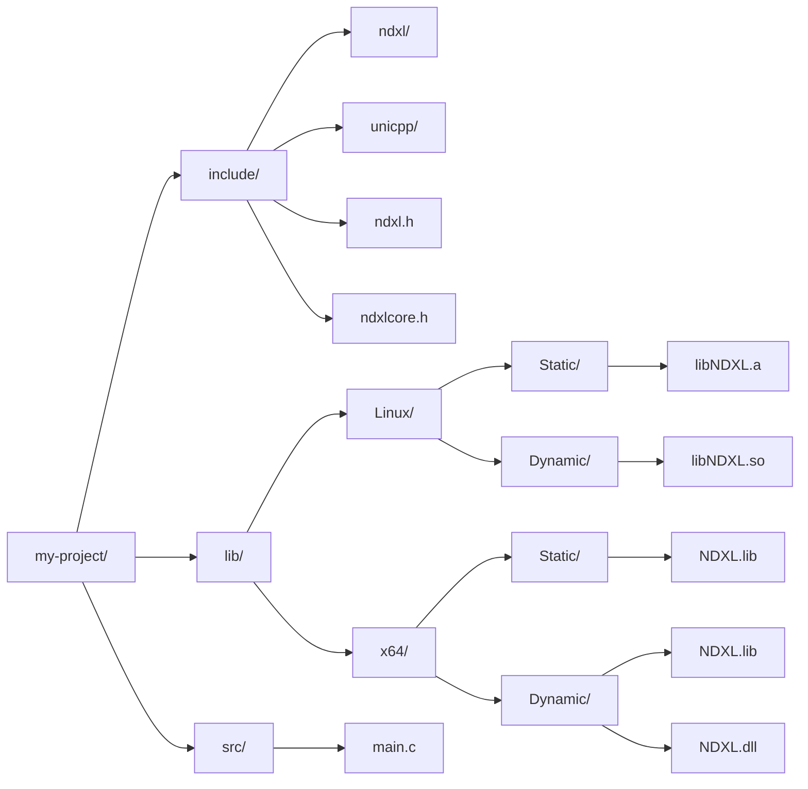

# NDXL


Network Dynamics eXperimentation Library (NDXL) is a cross-platform, language-independent C library for simulating complex networks and their dynamics.
NDXL places particular emphasis on networks whose topologies — the number of agents and their connectivity — evolve over time.
The library is written in C using only primitive and opaque types, making it straightforward to interface with from other programming languages (see, for example, the [Python implementation](https://pypi.org/project/ndxl/)).

## Features
The core object in NDXL, `NDXLNetwork`, serves as the basis for building a network from vertices (`NDXLVertex`; resident components) and edges (`NDXLEdge`; coupling between components) representing a complex system, which can then be numerically simulated.
Vertex and edge dynamics are defined independently, allowing heterogeneous components and combinations of different dynamical behaviours.
Supported dynamics include:

- Ordinary differential equations (ODEs)
- Stochastic differential equations (SDEs)
- Static agents (no dynamics)

Vertices can additionally depend on delayed states of their nearest neighbours and the edges that join them (delay differential equations; DDEs).
These behaviours are not mutually exclusive: for example, a vertex can have stochastic dynamics while depending on delayed states of its neighbours, whereas another vertex may use only delayed states and the connecting edges remain static.

## NDXL Use-Cases
A wide variety of scientific disciplines rely on network-based modelling to simulate complex systems composed of interacting, potentially heterogeneous components.

- Physics/chemistry: gas-particle ensembles, solid atomic lattices, many-body problem
- Engineering: power grids, oscillator networks, heat flow, Josephson junctions
- Biology: predator-prey communities, algal communities, viral infection
- Sociology: follower networks, friend groups
- Information technology: client-server interactions, internet of things

In addition to simulating these networks under standard conditions, NDXL shines when simulating these networks subject to evolving topologies:

- A power grid with generators and loads constantly being added/removed
- An individual-based ecological model in which organisms reproduce, die, and interact with a changing population
- A computer network with servers going up/down and clients connecting/disconnecting
- An ensemble of gas particles that slowly leak into the environment

## Getting Started
The precompiled libraries and header files are found in [NDXL/lib](./NDXL/lib/) and [NDXL/include](./NDXL/include/), respectively.
Language-specific bindings and their installation guides can be found in [bindings](./bindings/).

### C
Assuming your working tree looks something like this:



In main.c, we will define a simple Kuramoto oscillator network:

```C
#include <math.h>

#include "../include/ndxl.h"

// Define mean-field-normalised Kuramoto dynamics for a single oscillator
int kuramoto(NDXLVertex* vert, double* dtheta, const double* theta, double time, void* params)
{
    double omega = *(double*)params;
    double coupling = 0.0;
    
    // Iterate over only vertices coupled to 'vert'
    for (NDXLEdge* edge = ndxlGetVertexFirstEdge(vert); edge; edge = ndxlGetVertexNextEdge(vert, edge))
        coupling += ndxlEdgeState(edge)[0] * sin(ndxlGetVertexNeighbourState(vert, edge)[0] - theta[0]);
        
    // Output derivative written in-place
    dtheta[0] = omega + coupling / (1.0 + ndxlGetVertexDegree(vert));
    
    // Indicate function succeeded (e.g., no division by 0 errors)
    return 0;
}

int main(int argc, char** argv)
{
    // MUST be called before any calls to NDXL functions
    ndxlInit();
    
    // Create host network and space for four vertices
    NDXLNetwork* nwk = ndxlCreateNetwork(0);
    NDXLVertex* oscillators[4];
    
    // Identical eigenfrequency for all - must persist over objects' lifetimes
    const double omega = 1.0;

    // Add four Kuramoto oscillators equally spaced in phase space
    for (int i = 0; i < 4; i++)
    {
        // PI and TWO_PI are defined in "../include/unicpp/unicpp_vals.h"
        const double theta0 = -PI + (i / 3.0) * TWO_PI;
        oscillators[i] = ndxlCreateVertex(
            nwk,        // Host network
            &theta0,    // Initial state vector
            1,          // Number of elements in state vector
            kuramoto,   // Dynamics
            NULL,       // No noise
            NULL,       // Noise channels array - must be NULL if noise is NULL
            0,          // Number of elements in noise channels array - must be 0 if noise is NULL
            NULL,       // No vertex discrete callback
            &omega      // Arbitrary extra parameters pointer (NOT COPIED!!)
        );
    }
    
    // Define topology by creating edges - we shall do an all-to-all coupling (complete graph) with uniform coupling K
    const double K = 1.0;
    for (int i = 0; i < 4; i++)
    {
        for (int j = i + 1; j < 4; j++)
        {
            ndxlCreateEdge(
                oscillators[i], // 'Source' vertex of edge
                oscillators[j], // 'Destination' vertex of edge
                &K,             // Initial state vector
                1,              // Length of state vector
                0.0,            // Delay (for defining DDEs)
                0,              // Not directed (any truthy value makes the edge directed)
                NULL,           // No dynamics (static edge)
                NULL,           // No noise
                NULL,           // Noise channels array - must be NULL if noise is NULL
                0,              // Number of elements in noise channels array - must be 0 if noise is NULL
                NULL,           // No edge discrete callback
                NULL            // Arbitrary extra parameters pointer (NOT COPIED!!)
            );
        }
    }
    
    // Simulate using Dormand-Prince Runge-Kutta pair of order 5(4)
    ndxlNetworkSimulate(
        nwk,    // Target network to simulate
        10.0,   // Length of simulation (starts at ndxlGetNetworkTime(nwk), which is 0 when created)
        1e-6,   // Absolute tolerance
        1e-3,   // Relative tolerance
        NULL,   // No time-stops array (forced evaluation points)
        0,      // Length of time stops array - must be 0 if time stops is NULL
        NULL    // No discrete network callback
    );
    
    // Remaining NDXL objects are automatically destroyed at program termination
    return 0;
}
```

The NDXL [documentation](https://github.com/NonlinearC/NDXL) provides detailed explanations of the library's architecture, concepts, API functions and usage, together with tutorials covering its functionality.

## Contributing
Questions and bug reports on this page are welcome; for details, see [how to contribute](CONTRIBUTING.md).

## Citing NDXL
pls add me to paper

## License
NDXL is released under the GNU GPL-3.0 license, allowing users to create their own derivative works and distribute them under the same licensing conditions.
Official language bindings are distributed under the same licence.
Users are also welcome to develop their own external wrappers for NDXL (see the [documentation](https://github.com/NonlinearC/NDXL) for details).