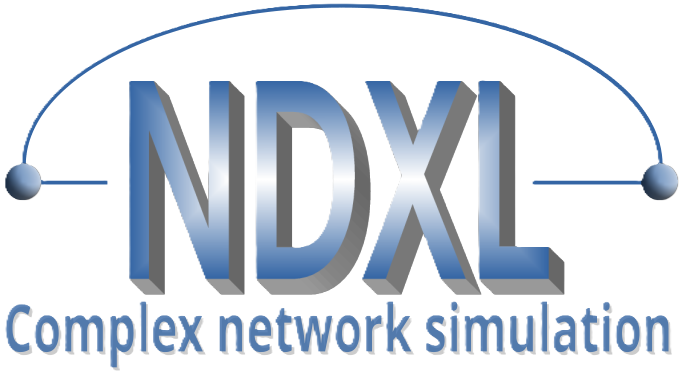

# NDXL


This page serves as a brief introduction to the Python wrapper for NDXL; for the C API and source code, see the [C API](https://github.com/NonlinearC/NDXL).
NDXL can be installed via pip:

```
pip install ndxl
```

To install from an external Python environment manager like conda, you may have to install pip in your virtual environment first:

```
conda activate venv
conda install pip
```

Then simply run:

```
python -m pip install ndxl
```

## Writing
NDXL uses [NumPy](https://numpy.org/) for interfacing with the C API, so we recommend always importing the two packages in tandem.
To use NDXL, we first need to do create a host network for our agents to exist on.

```python
import ndxl
import numpy as np

# We can optionally provide the constructor with an args tuple, which we leave empty for now
nwk = ndxl.create_network()
```

The next task is to define the dynamics functions of our agents, on a per-agent basis.
Our goal is to simulate a network of Kuramoto oscillators; in this network, a vertex is an oscillator, and an edge is a coupling between two oscillators.
Since coupling in the Kuramoto model is static, we need only define the dynamics for our vertices.

```python
def kuramoto(vert, y, t, w):
    # Iterate over only vertices and edges explicitly coupled to `vert`
    return w + np.sum([e.state * np.sin(vert.neighbour_state(e) - y) for e in vert.edges])
```

The function above indicates our intent to have the eigenfrequency of an oscillator passed as its `args` parameter.
In NDXL, this can either be a tuple, or a scalar, which is converted to a 1-tuple.
Similarly for the state vector, we can either pass an iterable (like a list, tuple, or NumPy array), or a scalar, which gets converted to a NumPy array of length 1.
To specify that the vertices must use the `kuramoto` function we defined, we use the `dynamics` keyword in their constructor.

```python
# Equally spaced eigenfrequencies and initial phases
omega = np.linspace(9.9, 10.1, 5)
theta = np.linspace(-np.pi, np.pi, 5)

# Create oscillators and store references
oscillators = np.empty(5, dtype=ndxl.vertex)
for i in range(5):
    oscillators[i] = nwk.create_vertex(theta[i], dynamics=kuramoto, args=omega[i])
```

We now define the topology by constructing edges between the vertices.
In this example, we will create a ring network with uniform coupling `K`.
Edges can either be created:
- On the source vertex, in which case the first argument is the destination vertex
- On the network, in which case the first two arguments are the source and destination vertices, respectively
Since the edges are static, we do not pass the `dynamics` argument.

```python
K = 1.0
for i in range(5):
    oscillators[i].create_edge(oscillators[(i + 1) % 5], K)

# --- OR ---

for i in range(5):
    nwk.create_edge(oscillators[i], oscillators[(i + 1) % 5], K)
}
```

One last thing before we can simulate the network is to define how outputs are captured.
For this, we use a discrete network callback, which is called once at `t=0`, then again after each successful simulation step.
In our callback, we will gather copies the oscillator phases in `Python` lists for plotting later.
NOTE: simply using the `state` property without an index or `.copy()` will store references, which can be changed later, leading to faulty outputs!

```python
def cb(net, t, t_eval, p_eval):
	t_eval.append(t)
	for i, vert in enumerate(net.vertices):
		p_eval[i].append(vert.state[0])
```

Here, `t_eval` and `p_eval` correspond to the `args` provided to `nwk` during creation, so we must go back and modify that line to include these lists.
We then pass the callback into the `simulate` function, which by default uses:
- Dormand-Prince Runge-Kutta pair of order 5(4)
- Absolute tolerance of 10<sup>-6</sup>
- Relative tolerance of 10<sup>-3</sup>

```python
# Change (no params):
nwk = ndxl.create_network()

# To (params provided as tuple containing a list for t_eval, and a list of lists for p_eval):
nwk = ndxl.create_network(([], [[], [], [], [], []]))

# Simulate the network
nwk.simulate(
	10.0,	# Simulation duration (starts at nwk.time, which is 0 when created)
	cb=cb	# Use the output-capturuing callback we just defined
)
```

Outputs can now be accessed using the `params` property of the network.
`params[0]` contains the evaluated times, and `params[1][i]` contains the phase outputs of oscillator `i`.

```python
import matplotlib.pyplot as plt

for i in range(5):
	plt.plot(nwk.params[0], nwk.params[1][i], label=f"Oscillator {i+1}")
plt.xlabel("Time, $t$")
plt.ylabel("Phase, $\\theta$")
plt.legend()
plt.show()
```

## Output
Congratulations! You now have an output figure showing the simulated outputs of all five oscillators over time.

With this example, we have covered the fundamental steps involved in using NDXL: creating a network, defining agent dynamics, constructing network topology, and executing a simulation with custom output handling.

This is, of course, only a small demonstration of what NDXL can do. Vertices and edges can have independent dynamics, state vectors can have arbitrary dimensions, and simulations can incorporate stochastic processes, delays, and dynamically changing network structures.

For a more comprehensive understanding of the library, including its architecture, available functions, numerical methods, and additional examples, please refer to the [Python documentation](https://github.com/NonlinearC/bindings/python/).

## License
NDXL is released under the GNU GPL-3.0 license, allowing users to create their own derivative works and distribute them under the same licensing conditions.
Official language bindings are distributed under the same licence.
Users are also welcome to develop their own external wrappers for NDXL (see the [documentation](https://github.com/NonlinearC/NDXL) for details).